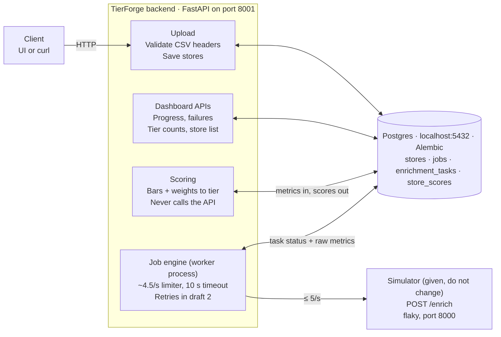

# TierForge Backend — Requirements in Plain English

Oct 22, 2026 · Sayan Sarkar

## In one page

The user does four things, in order. Each one maps to one or two endpoints.

1. **Upload the CSV** — `POST /api/uploads`
    - Check the headers are exactly `store_id, store_name, address, city, state, country`; reject with a clear error if not.
    - Save each row as a store. Nothing is enriched yet.
2. **Start enrichment** — `POST /api/jobs`
    - The API creates one job and one task per store in Postgres, then returns immediately.
    - Only one job may run at a time.
    - The **worker** (a separate process) picks up the tasks and calls the simulator for each store, within the 5 calls/second limit.
    - **Draft 1:** each store gets exactly one call. Any 429, 500, timeout or connection error marks that store `FAILED` with the reason. No retries.
    - **Draft 2:** retries 500s and timeouts a capped number of times with backoff, takes back work from calls that hang, ignores answers that arrive too late, and stops the whole job if everything is failing.
    - The worker does not create jobs; it only processes tasks.
3. **Score and tier** — `POST /api/jobs/{id}/scoring`
    - **One call** both sets the scoring rules (a bar and a weight per metric, plus the Large and Medium thresholds) and computes the results.
    - Score = sum of the weights of the bars a store clears. Tier comes from the thresholds.
    - It uses only the saved metrics and never calls the simulator. The user can re-run it with new numbers as often as they like.
4. **Look at the dashboard** — read-only endpoints
    - `GET /api/jobs/{id}`: progress (succeeded / failed / pending counts)
    - `GET /api/jobs/{id}/failures`: why each failed store failed
    - `GET /api/jobs/{id}/summary`: Large / Medium / Small counts
    - `GET /api/jobs/{id}/stores?tier=`: store list with metrics, score and tier, filterable by tier

Processes: the **API** (port 8001) handles steps 1, 3 and 4 and creates the job in step 2. The **worker** (no port) does the enrichment. Both share Postgres. In draft 1 the worker keeps calls under the limit with an in-process limiter (see [documentation/01-rate-limiting.md](documentation/01-rate-limiting.md)); a shared Redis limiter comes later, if we run more than one worker process.

## The big picture

You build a backend that takes a CSV of 5,000 stores, gets 3 numbers for each store from a slow and unreliable API, saves them, and then sorts every store into Large, Medium or Small using rules the user sets.

The work splits into two halves that must stay separate:

1. **Enrichment (slow, unreliable).** A background job calls the provided simulator once per store to get footfall, revenue and size. Most of the difficulty sits here: rate limits, random errors, hung calls.
2. **Scoring and tiering (fast, local).** Using only the numbers already saved, compute a score and a tier for every store. It never calls the API, and the user can re-run it any number of times with new settings.

This is a Tech Lead take-home (2–3 days). The graders care most about how the job engine survives failures, avoids lost or double-counted work, and how the database models it. A plain CRUD app with retries bolted on will not score well.

## What you are given

You get two things: a ready-made simulator that you run but never change, and a sample CSV with 5,000 rows. You build everything else.

### The enrichment simulator (`enrichment_simulator/`)

A small FastAPI app that stands in for a third-party API. Start it with `uvicorn main:app --port 8000` and treat it as a black box.

- `POST /enrich` takes `store_id`, `store_name`, `address`, `city`, `state` and returns `estimated_monthly_footfall`, `estimated_monthly_revenue`, `store_size_sqft`. It does not take `country`.
- `GET /health` returns `{"status": "ok"}` and has no rate limit.
- Results are **deterministic**: the same `store_id` always returns the same numbers, so writing the same result twice is harmless.

| Behaviour | How often | What the code really does |
| --- | --- | --- |
| Normal success (200) | \~88% | Responds in 0.2–0.5 s |
| Rate limited (429) | Whenever more than 5 calls arrive within the same 1-second window | One global counter for all callers. Rejected calls still count toward the window. |
| Transient error (500) | \~10% of calls that pass the rate limit | Fails after 0.2–0.5 s. Safe to retry. |
| Hang, then success (200) | \~2% of calls that pass the rate limit | Waits a fixed 50 s (the README says 45–60 s), then returns valid data |

Value ranges, useful for test fixtures and for sensible default bars: footfall 500–50,000, revenue 5,000–500,000, size 200–20,000 sqft.

### The sample CSV (`stores_5000.csv`)

5,000 rows with columns `store_id, store_name, address, city, state, country`. I checked it: no duplicate IDs, no blank cells, no commas inside values. Every row is in India, spread across New Delhi, Mumbai and Bengaluru.

### What the rate limit means for timing

At 5 calls per second, 5,000 stores take at least \~17 minutes (\~18.5 at the 4.5/s we actually use). Draft 2's retries add \~10% more calls. So enrichment must run as a background job, and the API must return right away and let the client poll for progress.

## What you need to build

The backend is one FastAPI service, organised as four parts that share a Postgres database. The enrichment workers run inside the service as background tasks.



Upload, scoring and the dashboard APIs only touch Postgres. The job engine is the one part that calls the simulator, so its slowness and failures never reach scoring.

### Your stack

- **Repo:** `sigmoid-tierforge/` monorepo with `backend/` now and `frontend/` later. The simulator stays in `enrichment_simulator/`, untouched.
- **API:** FastAPI, using dependency injection for the DB session, settings, the enrichment client, the rate limiter and the service classes, so tests can swap in fakes.
- **Database:** your existing Postgres on `localhost:5432`, no Docker. Schema managed with Alembic migrations.
- **Ports:** the simulator already uses 8000, so run the backend on another port (e.g. 8001).
- **Config from env:** `DATABASE_URL`, `ENRICHMENT_BASE_URL`, and the tuning knobs (rate, timeout, max attempts, worker count).

### The four parts

1. **Upload.** Accept the CSV, check the headers, save each row as a store, and give the batch an ID.
2. **Enrichment job engine.** Create one task per store. The worker claims tasks, calls the simulator through the rate limiter, and records the outcome on the task. Draft 1 makes one attempt per store; draft 2 adds the failure handling listed under Business rules.
3. **Scoring.** A pure function plus one bulk DB write. It reads saved metrics, applies the user's bars, weights and tier thresholds, and stores a score and tier per store.
4. **Read APIs for the dashboard.** Job progress, failure reasons, tier counts, and a store list you can filter by tier.

### Data model — four tables

Two you already expected (`stores`, `jobs`), plus one for the per-store work and one for the computed scores. The raw metrics (slow to get) and the scores (cheap to recompute) live in different tables, so re-scoring can never touch enrichment data.

| Table | One row per | Columns | Written by |
| --- | --- | --- | --- |
| `stores` | row of an uploaded CSV | id, upload_id (UUID shared by all rows of one file), store_id, store_name, address, city, state, country, created_at. Unique on (upload_id, store_id). | Upload, once |
| `jobs` | enrichment run | id, upload_id, status, total_stores, scoring_config (JSONB, latest settings), error, created_at, started_at, finished_at | API creates it; worker updates status; scoring saves its settings here |
| `enrichment_tasks` | store within a job: the unit of work and its raw result | id, job_id, store_id (→ stores.id), status, attempt_count, last_error, footfall, revenue, size_sqft, enriched_at, updated_at. Unique on (job_id, store_id). | API creates them as `PENDING`; worker fills in the outcome |
| `store_scores` | scored store in a job | job_id, task_id, score, tier, scored_at. Primary key (job_id, task_id). | Scoring: deleted and rewritten in one transaction on every run |

What each one answers:

- **`stores`:** what are the stores? The input data, never changed.
- **`jobs`:** is the run going or finished, and with which scoring settings were its stores last scored?
- **`enrichment_tasks`:** for each store in this job, did it succeed (and with what numbers) or fail (and why)? Progress counts are `COUNT(*) GROUP BY status`.
- **`store_scores`:** what score and tier does each successfully enriched store have now?

Dropped from the earlier eight-table draft:

| Dropped | Replaced by |
| --- | --- |
| `store_uploads` | the `upload_id` column on `stores` and `jobs` |
| `enrichment_attempts` | `attempt_count` + `last_error` on the task (no per-call history) |
| `enrichment_results` | metric columns on the task, filled once when it succeeds |
| `scoring_configs` | the `scoring_config` JSONB column on `jobs` (latest settings only) |

**Statuses.**
- Task: `PENDING → IN_PROGRESS → SUCCEEDED | FAILED`.
- Job: `PENDING → RUNNING → COMPLETED | COMPLETED_WITH_FAILURES`. Draft 2 adds `FAILED` for the circuit breaker.
- Store statuses as text with a CHECK constraint, so adding a value later is a simple migration.

**Room left for draft 2.** Retries need no new tables, only new columns added through one Alembic migration:
- **Already there:** `attempt_count` (always 1 in draft 1) and `last_error`.
- **To add:** `next_attempt_at` (for backoff) and `lease_expires_at` (for taking back hung work) on `enrichment_tasks`.
- **No change:** the worker writes the result with a guarded update (`… WHERE status <> 'SUCCEEDED'`), so a late or duplicate answer can't overwrite a finished task. Draft 1 already works this way.

## API endpoints to expose

The brief does not fix any paths. This is a minimal set that covers Steps 1–4 and gives the frontend everything it needs later.

| Step | Method + path | Does | Returns / notes |
| --- | --- | --- | --- |
| 1 | `POST /api/uploads` (multipart CSV) | Checks the headers, saves the stores | `upload_id`, `row_count`. Returns 422 with a clear message if a column is missing, extra or misspelled, or the file is empty or not a CSV. |
| 2 | `POST /api/jobs` `{upload_id}` | Creates the job and one task per store, starts workers | `job_id`, right away. Returns 409 if a job is already running (one job at a time). |
| 2 | `GET /api/jobs/{id}` | Job progress | status, total / succeeded / failed / pending / in-progress counts, timestamps, terminal failure reason |
| 2 | `GET /api/jobs/{id}/failures` | Why stores failed | store_id, name, attempts made, last error (draft 1: "500", "timeout"; draft 2: "500 after 5 attempts") |
| 3 | `POST /api/jobs/{id}/scoring` | Applies bars, weights and tier thresholds to saved metrics. Never calls the API. | tier breakdown. Can run while enrichment is still going (it scores whatever has succeeded) or only after it finishes; pick one and document it. |
| 4 | `GET /api/jobs/{id}/summary` | Dashboard header | job counts + Large / Medium / Small counts from the latest scoring |
| 4 | `GET /api/jobs/{id}/stores?tier=Large&page=1&page_size=50` | Store list | name, footfall, revenue, size, score, tier; filter by tier, paginated |
| — | `GET /api/health` | Liveness | Can also report whether the DB and simulator are reachable |

Request body for scoring:

```json
{
  "bars":    {"footfall": 15000, "revenue": 150000, "size_sqft": 8000},
  "weights": {"footfall": 50,    "revenue": 30,     "size_sqft": 20},
  "tiers":   {"large_min": 70, "medium_min": 40}
}
```

## Business rules

### Scoring and tiering

A store's score is the sum of the weights of every bar it clears. Nothing else: no normalising, no ranges.

```
score = w_footfall × [footfall ≥ bar_footfall]
      + w_revenue  × [revenue  ≥ bar_revenue]
      + w_size     × [size     ≥ bar_size]
```

- **Tier:** score ≥ Large threshold → Large; else score ≥ Medium threshold → Medium; else Small.
- **Validation:** each weight 0–100 and the three add up to exactly 100. Bars ≥ 0. 0 ≤ Medium threshold ≤ Large threshold ≤ 100. Reject bad input with 422.
- **Only successfully enriched stores** get a score. Failed stores appear in the failures list, not the tier counts.
- **Re-runnable:** each run replaces the previous scores for that job in one transaction. Running it twice with the same settings gives the same result.
- **Fast:** at most 5,000 rows, so do it as one read and one bulk write, or a single SQL `INSERT … SELECT` with `CASE` expressions.

The brief's worked example doubles as your first unit test (bars 15,000 / 150,000 / 8,000; weights 50 / 30 / 20; Large ≥ 70, Medium ≥ 40):

| Store | Footfall | Revenue | Size (sqft) | Bars cleared | Score | Tier |
| --- | --- | --- | --- | --- | --- | --- |
| A | 40,000 | 400,000 | 18,000 | all three | 100 | Large |
| B | 20,000 | 100,000 | 5,000 | footfall | 50 | Medium |
| C | 2,000 | 20,000 | 9,000 | size | 20 | Small |

Also test the edges: a value exactly equal to a bar, a score exactly 70 or 40, and a weight of 0.

### Surviving the flaky API

This is the core of the exercise, and it is built in two drafts.
- **Draft 1** gives each store exactly one call and records how it ended. Expect roughly 12% of stores to fail: the ~10% of calls that return 500, plus the ~2% that hang.
- **Draft 2** adds the bounded recovery the brief requires.

| Situation | Draft 1 (now) | Draft 2 (target) |
| --- | --- | --- |
| **429 rate limited** | Prevented by the in-process limiter at ~4.5 calls/s. If one still happens, the task is `FAILED` with reason `429`. | Same limiter (shared through Redis if there are several worker processes). A 429 is retried after a short wait and doesn't use up the store's attempt budget. |
| **500 transient error** | Task `FAILED`, reason `500` | Retry with exponential backoff and jitter (e.g. 1 s, 2 s, 4 s …), up to a cap (e.g. 5 attempts). Then `FAILED` with the reason. |
| **Call hangs (50 s)** | 10 s client timeout, then task `FAILED`, reason `timeout` | Same timeout; counts as a failed attempt and the task is put back for retry |
| **Late answer from a call you gave up on** | Can't happen: the client abandons the connection when the timeout fires | Harmless: the guarded update (`WHERE status <> 'SUCCEEDED'`) ignores duplicates, so counts never double |
| **Worker goes silent** (crash, stuck coroutine) | Tasks stay `IN_PROGRESS`; known limitation | Tasks are claimed with a lease (`lease_expires_at`) using `SELECT … FOR UPDATE SKIP LOCKED`. A reaper puts expired leases back to `PENDING`. |
| **Run is broken across the board** (simulator down, everything failing) | Every task fails once and the job ends `COMPLETED_WITH_FAILURES`, so it can't loop | Job-level circuit breaker (e.g. N failures in a row) stops the run and marks the job `FAILED` with a clear reason |

**Job states:** `PENDING → RUNNING → COMPLETED` (everything succeeded) or `COMPLETED_WITH_FAILURES` (some stores failed). Draft 2 adds `FAILED` (circuit breaker tripped).

**Task states:** `PENDING → IN_PROGRESS → SUCCEEDED | FAILED`. In draft 2, a failed attempt under the cap goes back to `PENDING` with a later `next_attempt_at`.

## Scope, tests and deliverables

The core is Steps 1–4, end to end, with one job at a time. Don't start the bonus items until the core works.

|  | Item |
| --- | --- |
| **Must have: draft 1** | Upload with header validation; background enrichment job (one attempt per store, rate limited, 10 s timeout) with progress and failure reasons; fast, re-runnable scoring; dashboard read APIs |
| **Must have: draft 2** | Retries with capped attempts and backoff; reclaiming hung work with no double counting; circuit breaker with a terminal `FAILED` state |
| **Bonus** | Several jobs running at once while still sharing one 5/s limit. Resuming after a restart: kill the server mid-job, and on startup it carries on without redoing finished stores. |
| **Out** | Auth, Docker, deployment, building your own enrichment API |

Resuming after a restart comes almost free if task state and leases live in Postgres rather than in memory. On startup, the reaper hands back expired leases and the workers pick up `PENDING` tasks. Worth doing even though it is a bonus.

**Tests** (optional but a strong signal), runnable with one command such as `pytest`:

- Retry/backoff: delays grow, attempts stop at the cap, a 429 doesn't use up the failure budget
- Timeout and late answer: a slow fake client doesn't produce duplicate results or double-counted progress
- Circuit breaker trips on sustained failures and leaves the job `FAILED`
- Scoring formula and tier boundaries (the worked example + edge values)
- CSV header validation: missing column, extra column, wrong order (decide whether order matters), empty file

**Deliverables:** a git repo with `backend/` (and `frontend/` later). It needs a README covering setup, how to run the simulator alongside the app, running Alembic migrations, the test command, a short note on architecture decisions, and known limitations.

## Corrections and open questions

Your reading is right: the simulator is provided, you run it locally, and you must not change it. A few details are easy to miss:

- **The UI is still a deliverable.** Steps 3 and 4 say "via the UI". Doing the backend first is fine, but its responses must carry everything the dashboard needs.
- **The simulator's README and code disagree slightly.** The README says hangs last 45–60 s; the code waits exactly 50 s. Build for "any long hang" and don't rely on either number.
- **The rate limit is one global fixed 1-second window,** and rejected calls still count toward it. Sending faster than 5/s and leaning on 429s wastes throughput. A client-side limiter is the real fix.
- **`country` is in the CSV but not in the API request.** Store it; don't send it.
- **Port clash:** the simulator and FastAPI both default to 8000.

### Open questions (decide and write them in the README)

- [ ] Does a store clear a bar at exactly the bar value (≥) or only above it (>)? This doc assumes ≥, since the brief calls the bar "the minimum value that counts as strong".
- [ ] Must CSV columns come in the given order, or just all be present? Are extra columns rejected?
- [ ] Beyond headers, should rows with blank fields or duplicate `store_id`s be rejected, skipped, or reported?
- [ ] Can scoring run while enrichment is still in progress, or only after the job finishes?
- [ ] Keep a history of scoring configs, or only the latest? (The four-table model keeps only the latest, on `jobs`.)
- [ ] Exact numbers: request timeout, max attempts per store, circuit-breaker threshold, worker count.
