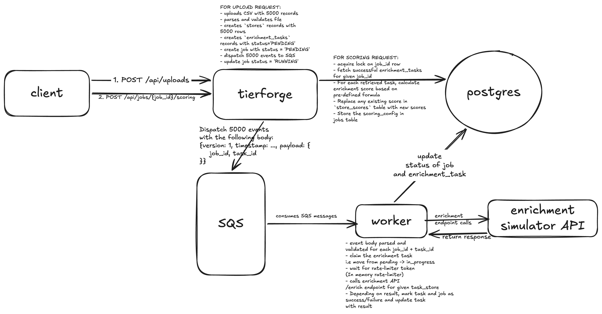
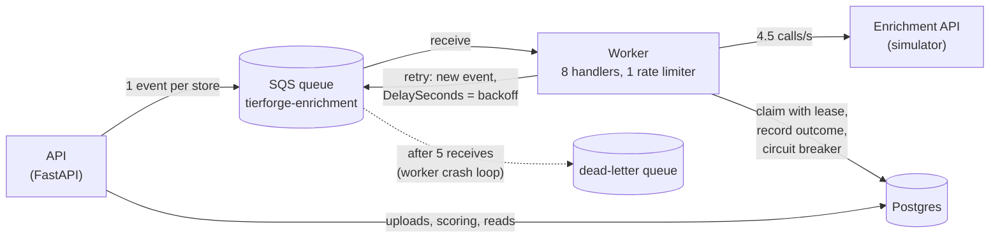
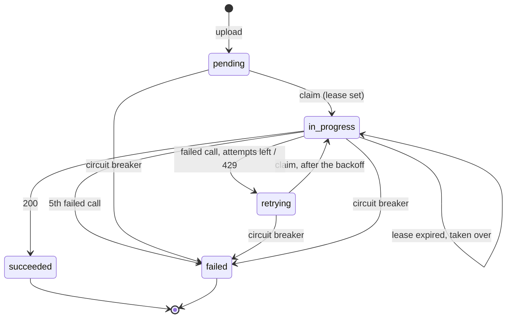
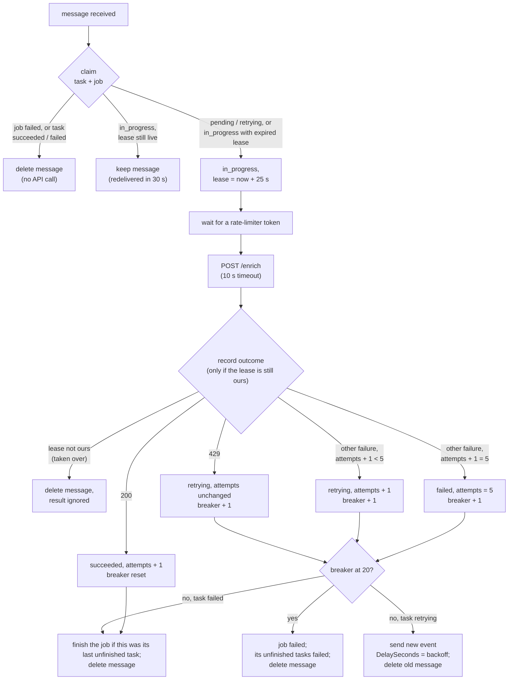

# Architecture

High-level design of the TierForge backend.

- What it must do: [REQUIREMENTS.md](REQUIREMENTS.md).
- Every table, column and index: [datastores.md](datastores.md).
- Known limitations and trade-offs: [limitations-and-tradeoffs.md](limitations-and-tradeoffs.md).
- The frontend that calls this API: [FE_Architecture.md](FE_Architecture.md).

1. [Draft 1: enrichment without retries](#1-draft-1-enrichment-without-retries) (implemented; superseded by draft 2)
2. [Draft 2: retry with backoff](#2-draft-2-retry-with-backoff) (implemented)

## 1. Draft 1: enrichment without retries

Every store gets exactly one enrichment call; a failed call fails that store with its reason. Draft 2 (§2) builds on this design and changes what the worker does with a failed call; everything else here still applies.



### Components

| Component                                                      | Runs as                              | Responsibility                                                                                                     | Talks to                                        |
| -------------------------------------------------------------- | ------------------------------------ | ------------------------------------------------------------------------------------------------------------------ | ----------------------------------------------- |
| **API** (FastAPI)                                              | `poe api`, port 8001                 | Validate and save uploads; create jobs and send their events; score jobs; serve job, progress and store reads      | Postgres; SQS (send)                            |
| **Worker**                                                     | `poe worker`, no port                | Consume enrichment events; call the enrichment API within its rate limit; record each store's outcome; finish jobs | SQS (receive, delete); Postgres; enrichment API |
| **Postgres**                                                   | local container / RDS                | Source of truth: stores, jobs, per-store tasks and results, scores                                                 | —                                               |
| **SQS** queue `tierforge-enrichment` and its dead-letter queue | LocalStack locally; Terraform in AWS | Hands work from the API to the worker, one event per store                                                         | —                                               |
| **Enrichment API** (provided simulator)                        | `poe simulator`, port 8000           | Returns three metrics per store; flaky, and limited to 5 calls/s across all callers                                | —                                               |

The API and the worker are one Python codebase (shared models, repositories and services) run as two processes. Inside it, **routes** handle HTTP only, **services** own business rules and decide when to commit, and **repositories** only read and write data, never committing.

### Data model

| Table              | One row per                          | Holds                                                                    |
| ------------------ | ------------------------------------ | ------------------------------------------------------------------------ |
| `stores`           | row of an uploaded CSV               | the store as uploaded; never changed                                     |
| `jobs`             | enrichment run of one upload         | status, timestamps, error; the latest scoring settings and when they ran |
| `enrichment_tasks` | store within a job: the unit of work | status, attempts, last error, and the three metrics once enriched        |
| `store_scores`     | scored store within a job            | score and tier from the job's latest scoring                             |

Metrics are slow to get and never change; scores are cheap and rewritten on every scoring run. Keeping them in separate tables means scoring can never touch enrichment data.

**Statuses** (plain `TEXT` in Postgres, `StrEnum`s in code):

- **Job:** `pending → running → completed | completed_with_failures`, or `failed` if its events couldn't be sent.
- **Task:** `pending → in_progress → succeeded | failed`.

### Flow 1: upload (`POST /api/uploads`)

1. Validate the CSV, all or nothing: any problem → 422 listing every issue; over 10 MB → 413.
2. In one transaction: insert the stores, a `pending` job, and one `pending` task per store. **Commit.**
3. Send one SQS event per task, with `SendMessageBatch` (10 per call, up to 10 calls in parallel). Event body:
   ```json
   {
     "version": 1,
     "timestamp": "2026-10-23T10:15:30Z",
     "payload": { "job_id": 7, "task_id": 1234 }
   }
   ```
4. Mark the job `running`, commit, and return `201 {upload_id, row_count, job_id, job_status}`.

- **Commit before sending:** the worker never receives an event for a row it can't see.
- **If sending fails,** the job is marked `failed` with the reason, and the upload returns 503. The stores stay saved, and events already sent are skipped by the worker, because their job has failed.
- **Measured:** 5,000 stores saved and queued in about 1.7 s.

### Flow 2: enrichment (worker)

The worker long-polls SQS into a small buffer, and **8 handlers** take messages from it, all sharing **one rate limiter**. For each event, a handler:

1. **Parses** the event and checks its version. Malformed or unsupported messages are deleted.
2. **Claims** the task (`pending → in_progress`) and loads its store, in one guarded update: only if the task is still `pending` and its job hasn't failed. If the claim fails (a duplicate delivery, or a failed job), it deletes the message without calling the API.
3. **Waits for a token** from the rate limiter: an in-process token bucket at **4.5 calls/s** with capacity 1. Calls go out evenly spaced, about 222 ms apart with no bursts, so they never exceed the API's 5 calls/s.
4. **Calls `POST /enrich`** with the store's details and a 10 s total timeout.
5. **Records the outcome**, guarded on the task still being `in_progress`:

   | Outcome                                                 | Task becomes               | `last_error`                              |
   | ------------------------------------------------------- | -------------------------- | ----------------------------------------- |
   | 200 with valid metrics                                  | `succeeded`, metrics saved | —                                         |
   | 429                                                     | `failed`                   | `rate limited (429)`                      |
   | 500 or other non-200                                    | `failed`                   | `upstream error (500)`                    |
   | no answer within 10 s (e.g. the API's 45–60 s hangs)    | `failed`                   | `timed out after 10s`                     |
   | connection refused or broken                            | `failed`                   | `connection failed: ClientConnectorError` |
   | 200 with a body that isn't valid metrics for this store | `failed`                   | `invalid response body: …`                |

6. **Finishes the job** if that was its last unfinished task: `completed` if every task succeeded, otherwise `completed_with_failures`. The update only applies to a `running` job, so exactly one handler finishes it.
7. **Deletes the message.**

**Timing:**

- No database connection is held while waiting for a token or during the call.
- At most about 26 messages are held at once, so a message waits at most ~6 s for a token plus 10 s for the call. That's well within the queue's 30 s visibility timeout.

**Measured on 5,000 stores:** 18 min 35 s (4.48 calls/s); 88% succeeded, 12% failed (500s and timeouts), zero 429s.

### Flow 3: scoring (`POST /api/jobs/{id}/scoring`)

The body carries a bar and a weight per metric, plus the Large and Medium thresholds. Invalid values → 422. Then, in **one transaction**:

1. Load the job and **lock its row** (`SELECT … FOR UPDATE`). A missing job → 404; a job whose enrichment hasn't finished → 409.
2. Read the metrics of the job's `succeeded` tasks.
3. Compute each store's **score** (the sum of the weights of the bars it meets) and **tier** (Large / Medium / Small).
4. Replace the job's `store_scores` rows: one delete, one bulk insert.
5. Save the settings and `scored_at` on the job.
6. Commit, and return the tier counts.

- **Never calls the enrichment API;** about 0.2 s for 5,000 stores; can be re-run at any time.
- **Readers** see either the old scores or the new ones, never a mix.
- **Concurrent scoring** of the same job runs one request after the other (the row lock); the last to commit wins.

### Flow 4: reading jobs and results

| Endpoint                                  | Returns                                                                                         | Reads                                        |
| ----------------------------------------- | ----------------------------------------------------------------------------------------------- | -------------------------------------------- |
| `GET /api/jobs`                           | jobs, newest first, paginated                                                                   | `jobs`                                       |
| `GET /api/jobs/{id}`                      | the job and its task counts per status (progress)                                               | `jobs`, `enrichment_tasks`                   |
| `GET /api/jobs/{id}/summary`              | progress, plus the latest scoring: settings, time, tier counts                                  | `jobs`, `enrichment_tasks`, `store_scores`   |
| `GET /api/jobs/{id}/stores?status=&tier=` | the job's stores with status, metrics, failure reason, score and tier; filterable and paginated | `enrichment_tasks`, `stores`, `store_scores` |

- **Reads never write.**
- **One error shape:** every error, including request validation, returns `{"detail": "...", "errors": [{"field": ..., "message": "..."}]}`.
  - `field` names the input a problem is about (e.g. `weights`, `bars.revenue`, `page_size`), so a form can show each message next to its input.
  - It's `null` when a problem isn't about one input, e.g. a CSV row.

### Key design decisions

| Decision                                                   | Why                                                                                                                                                              |
| ---------------------------------------------------------- | ---------------------------------------------------------------------------------------------------------------------------------------------------------------- |
| **An API and a worker, linked by SQS**                     | Uploads return in seconds while enrichment takes ~18 minutes. The slow, flaky part is isolated in the worker; scoring and reads never touch the enrichment API.  |
| **One SQS event per store**                                | Each store is delivered, redelivered on a crash, and deleted on its own, and work spreads across handlers (and across workers later).                            |
| **Postgres is the source of truth; events carry only IDs** | No store data is duplicated in messages; each task row holds its state.                                                                                          |
| **Every state change is a guarded update**                 | The claim, the result and the job's completion each check the current status in the same `UPDATE`, so duplicate deliveries and races can't apply a change twice. |
| **Token bucket at 4.5/s with capacity 1**                  | Evenly spaced calls stay under the API's fixed 1-second windows; the live run saw no 429s.                                                                       |
| **Results on the task row, scores in their own table**     | A task has at most one result; scores can be rewritten freely without touching results.                                                                          |
| **Scoring in Python, in one transaction, with a row lock** | The formula is one tested pure function; one read and one bulk write is fast at this scale; the lock stops concurrent runs from colliding.                       |

### Code layout

| Path                                          | Contents                                                                                          |
| --------------------------------------------- | ------------------------------------------------------------------------------------------------- |
| `backend/api/routes/`                         | HTTP endpoints: `uploads.py`, `jobs.py`, `health.py`                                              |
| `backend/api/services/`                       | business logic: `uploads/`, `jobs/` (`EnrichmentJobService`, `EnrichmentTaskService`), `scoring/` |
| `backend/api/repositories/`                   | data access, one per table                                                                        |
| `backend/api/models/`, `backend/api/schemas/` | SQLAlchemy models; Pydantic request, response and event models                                    |
| `backend/api/dependencies/`                   | the DB session, SQS client and enrichment API client                                              |
| `backend/worker/`                             | the SQS consumer and the rate limiter                                                             |
| `backend/migrations/`                         | Alembic migrations                                                                                |

## 2. Draft 2: retry with backoff

The alternatives considered for each decision are in [limitations-and-tradeoffs.md](limitations-and-tradeoffs.md#trade-offs-considered).

Draft 2 keeps every component of draft 1: no new process, queue or table. It changes what the worker does with a failed call, and adds three things:

- **Retries with backoff:** a failed call is retried after a growing, jittered delay, up to **5 calls per store** in total.
- **Leases:** a task whose worker died mid-attempt is taken over and retried, and a late result from the old worker is ignored.
- **A circuit breaker:** 20 failed calls in a row across a job's stores fail the whole job.

### Components and the retry loop



- **The retry loop goes through SQS.** A retry is a new event on the same queue, held invisible by SQS for the backoff delay. Nothing in the worker sleeps or waits.
- **Crash recovery also goes through SQS.** A message whose handler died is never deleted, so SQS redelivers it after its 30 s visibility timeout, and the lease lets the redelivery take the task over.

### Task statuses



The job's statuses are unchanged. A job finishes once none of its tasks is `pending`, `in_progress` or `retrying`, and becomes `failed` if the circuit breaker trips.

### Flow: one event



### The three limits

| Limit                                                             | Scope       | Counts                                                                                        | Reached →                                                                 |
| ----------------------------------------------------------------- | ----------- | --------------------------------------------------------------------------------------------- | ------------------------------------------------------------------------- |
| **Max attempts** (`ENRICHMENT_MAX_ATTEMPTS` = 5)                  | one store   | its failed calls (`attempt_count`); 429s don't count                                          | that task `failed`; the job carries on and ends `completed_with_failures` |
| **Lease** (`ENRICHMENT_LEASE_SECONDS` = 25)                       | one attempt | time since the claim                                                                          | the task may be taken over by the next delivery of its message            |
| **Circuit breaker** (`ENRICHMENT_CIRCUIT_BREAKER_THRESHOLD` = 20) | one job     | failed calls in a row, across its stores (`jobs.consecutive_failures`); any success resets it | the job `failed`; its unfinished tasks `failed`                           |

### Timers

| Timer              | Value                                                                            | Controls                                                    |
| ------------------ | -------------------------------------------------------------------------------- | ----------------------------------------------------------- |
| Call timeout       | 10 s                                                                             | when one API call counts as failed                          |
| Backoff            | 2 s × 2^(retry − 1), times 50–100% jitter, capped at 60 s: 1–2, 2–4, 4–8, 8–16 s | the wait before a retry, held by SQS                        |
| 429 delay          | ~1 s                                                                             | the wait before retrying a 429                              |
| Lease              | 25 s                                                                             | after this, an `in_progress` task's worker is presumed dead |
| Visibility timeout | 30 s (queue setting)                                                             | when SQS redelivers a message nobody deleted                |

### Data model changes

| Table              | New column                                                  | Purpose                                                         |
| ------------------ | ----------------------------------------------------------- | --------------------------------------------------------------- |
| `enrichment_tasks` | `lease_expires_at` (timestamptz, null unless `in_progress`) | the claim's lease; also the fencing token for the outcome write |
| `jobs`             | `consecutive_failures` (integer, default 0)                 | the circuit breaker's streak                                    |

`enrichment_tasks.status` gains the value `retrying` (statuses are `TEXT`, so no schema change).

### Where it lives in the code

| Path                                                   | Draft 2's part                                                                                                                                                                             |
| ------------------------------------------------------ | ------------------------------------------------------------------------------------------------------------------------------------------------------------------------------------------ |
| `backend/config/settings.py`                           | `EnrichmentConfig`: max attempts, backoff, 429 delay, lease, breaker threshold                                                                                                             |
| `backend/worker/backoff.py`                            | `Backoff`: the delay before a retry, in whole seconds, with jitter                                                                                                                         |
| `backend/worker/worker.py`                             | the per-event flow: claim → call → record → breaker → finish; then delete the message, keep it, or replace it with a delayed retry event; the lease vs visibility timeout check at startup |
| `backend/api/services/jobs/enrichment_task_service.py` | the claim (CLAIMED / BUSY / DONE) and the outcomes (`succeeded`, `retrying`, `failed`), each written only under the claim's lease                                                          |
| `backend/api/services/jobs/enrichment_job_service.py`  | the circuit breaker (`record_call_outcome`), and finishing a job once no task is unfinished                                                                                                |
| `backend/api/repositories/`                            | the guarded `UPDATE`s: the claim with its lease, lease-checked writes, the failure streak, failing a job's unfinished tasks                                                                |

### Measured on 5,000 stores

|                            | Draft 1     | Draft 2                                                                                                                                      |
| -------------------------- | ----------- | -------------------------------------------------------------------------------------------------------------------------------------------- |
| Succeeded                  | 4,399 (88%) | **5,000 (100%)**                                                                                                                             |
| Failed                     | 601         | **0**                                                                                                                                        |
| Calls (excluding any 429s) | 5,000       | 5,660                                                                                                                                        |
| Duration                   | 18 min 35 s | ~21 min of processing (24 min 12 s wall clock, including a ~3 min pause of the whole machine, during which the progress monitor stalled too) |

- **Attempts needed:** 4,410 stores on the 1st call, 528 on the 2nd, 56 on the 3rd, 4 on the 4th and 2 on the 5th. As expected: a store fails all 5 calls with probability 0.12⁵ ≈ 2.5 × 10⁻⁵.
- **The circuit breaker never tripped:** the job's failure streak ended at 0, and no lease was left behind.
- **Retries bunch up at the end:** first attempts finished at a steady ~235 stores/min; most retries ran in the last ~3 minutes, once their events reached the front of the queue. The rate limit, not the backoff, set the pace throughout.
