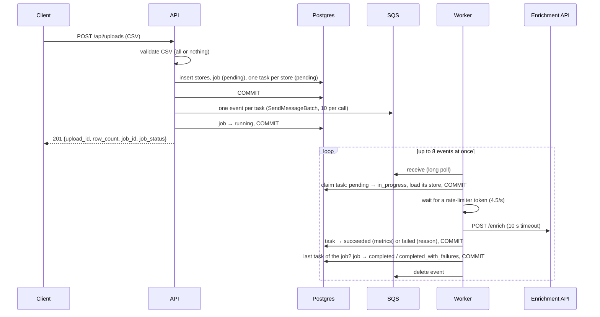

# Architecture

How TierForge's backend stores its data and how the API hands work to the worker. Retries, backoff and other resilience features are out of scope here; they come in phase 6 (see [implementation-phases.md](implementation-phases.md)).

## Components

| Component | Runs as | Talks to |
| --- | --- | --- |
| API (FastAPI) | `poe api` | Postgres, SQS (sends events). Scoring uses Postgres only. |
| Worker | `poe worker` | SQS (receives and deletes events), Postgres, enrichment API (`POST /enrich`) |
| Enrichment API | third party; locally the simulator (`poe simulator`, port 8000) | — |
| Postgres | your local instance / RDS | — |
| SQS queue `tierforge-enrichment` | LocalStack locally, Terraform in AWS | — |

## Layers

| Layer | Owns | Example |
| --- | --- | --- |
| Routes | HTTP: request parsing, status codes | `POST /api/uploads` |
| Services (`<feature>_service.py`) | business rules: which status a job or task moves to, which timestamps are set, what gets committed when | `EnrichmentJobService`, `EnrichmentTaskService` |
| Repositories | data access only: create, bulk create, get, count, update the fields they're given. They never commit. | `JobRepository.update(job_id, JobUpdate(...))` |

Repositories take Pydantic models (`JobCreate`, `JobUpdate`, `EnrichmentTaskCreate`, `EnrichmentTaskUpdate` in `api/schemas/`), and an update writes only the fields that were passed (`exclude_unset`). The worker uses the same services, building them on its own session.

One exception: `EnrichmentTaskRepository.update_if_status` checks the task's current status and writes the change in a single SQL statement. If a service read the status first and then updated it, two workers could both see `pending` and both claim the same task. The service chooses the transition (e.g. `pending` → `in_progress`); the repository keeps one fixed rule, which is to never touch tasks of a failed job. `JobRepository.update_if_status` does the same for jobs, so only one worker can finish a job.

## Upload to enrichment flow



Rules that keep this consistent:
- **Commit before sending.** Stores, job and tasks are committed before any event goes out, so the worker never receives an event for a row it can't see.
- **If sending fails,** the job is marked `failed` with the reason, and the upload returns 503. The stores stay saved. Events already sent are skipped by the worker, because their job has failed.
- **Claiming is guarded.** The worker only moves a task from `pending` to `in_progress` if the task is still `pending` and its job hasn't failed. A duplicate delivery of the same event changes nothing.
- **One event per store.** Each event is one unit of work, so SQS can spread work across workers, and each store is delivered and deleted on its own. Measured locally: 5,000 events sent in about 1 s; the whole upload took 1.2 s.
- **Recording is guarded too.** A task only moves to `succeeded` or `failed` from `in_progress`, so a result is never overwritten.
- **A job finishes exactly once.** After recording a task, the worker counts the job's tasks by status. If none is `pending` or `in_progress`, it moves the job from `running` to `completed` (every task succeeded) or `completed_with_failures` (some failed). Each worker commits its task before counting, so the last one to count sees every task finished; the guarded update lets only one worker finish the job. A `failed` job is never changed.

## Worker enrichment

For each event, the worker:

1. **Claims** the task (`pending` → `in_progress`) and loads its store, then commits. If the claim fails (duplicate delivery, or the job failed), it logs "skipped", deletes the event, and doesn't call the API.
2. **Waits for the rate limiter** (below).
3. **Calls `POST /enrich` once**, with a 10 s total timeout (`api/dependencies/enrichment.py`).
4. **Records the outcome** and commits:
    - 200 with valid metrics → `succeeded`, with footfall, revenue and size saved on the task;
    - anything else → `failed`, with the reason in `last_error`.
    Either way `attempt_count` goes up by one and `finished_at` is set.
5. **Finishes the job** if this was its last unfinished task.
6. **Deletes the event.**

Draft 1 makes exactly one call per store: a failed call is final. Retries come in phase 6.

**Failure reasons** saved in `last_error`:

| Outcome | `last_error` |
| --- | --- |
| 429 | `rate limited (429)` |
| 500 or another non-200 status | `upstream error (500)` |
| no response within the timeout (including the API's 45–60 s hangs) | `timed out after 10s` |
| connection refused or broken | `connection failed: ClientConnectorError` (the aiohttp error type) |
| 200 with a body that isn't valid metrics for this store | `invalid response body: …` or `response is for store …` |

**Rate limiting.** The enrichment API allows 5 calls/s across all callers, counted in fixed 1-second windows, and answers 429 above that. The worker uses an in-process token bucket (`worker/rate_limiter.py`) refilling at 4.5 tokens/s with a capacity of 1. Calls are therefore spaced evenly, about 222 ms apart, with no bursts: a burst at the end of one of the API's windows plus calls at the start of the next could exceed its limit, because its windows don't line up with ours. Spaced at 4.5/s, any 1-second span holds at most 5 calls, with margin for network jitter. The bucket is per process: running two workers doubles the rate. A shared limiter is phase 6 work.

**Concurrency.** One receiver loop long-polls SQS and fills a small buffer; 8 handler tasks (`ENRICHMENT_CONCURRENCY`) take messages from it, all in one process and one event loop. All of them share the one rate limiter, so the limiter alone sets the call rate. The handlers keep it busy: a call takes 0.2–0.5 s and a hung one up to the 10 s timeout, so one handler alone would manage only 2–3 calls/s. At 4.5 calls/s, 5,000 stores take about 18.5 minutes.

**Visibility timeout.** A message must be handled and deleted within the queue's visibility timeout (30 s), or SQS delivers it again. The buffer is only as large as the number of handlers, so at most about 26 messages are held at once: one received batch of 10, 8 in the buffer, and 8 being handled. That is about 6 s of waiting for the limiter, plus up to 10 s for the call: well within 30 s.

**Database connections.** The claim and the recording each use their own short session. No connection is held during the rate-limiter wait or the HTTP call.

**Known limitations (fixed in phase 6):**
- If the worker stops (Ctrl+C, deploy, crash) mid-call, its claimed tasks stay `in_progress`. SQS redelivers their events, but the claim then fails, so the tasks are never finished and their job stays `running`.
- The same happens if recording the outcome fails (e.g. the database is briefly unreachable).
- A 429 fails the store like any other error, although it means "try again later".

## Scoring and tiering

`POST /api/jobs/{job_id}/scoring` sets the scoring rules for a job and applies them in the same call. It only reads saved metrics and never calls the enrichment API, so it can be re-run as often as the user likes.

```json
{
  "bars":    {"footfall": 15000, "revenue": 150000, "size_sqft": 8000},
  "weights": {"footfall": 50,    "revenue": 30,     "size_sqft": 20},
  "tiers":   {"large_min": 70, "medium_min": 40}
}
```

**The formula** (`StoreScorer` in `api/services/scoring/scorer.py`, static methods with no database or I/O):
- **Score** = the sum of the weights of the bars the store meets. A value exactly equal to its bar meets it (`>=`).
- **Tier:** score `>= large_min` → `large`; else score `>= medium_min` → `medium`; else `small`. A score exactly at a threshold is in that tier.

**Validation** (422, by the request model `ScoringConfig`):
- each weight 0–100, and the three add up to exactly 100;
- bars `>= 0`;
- `0 <= medium_min <= large_min <= 100`;
- unknown keys are rejected, so a typo such as `revnue` fails instead of being ignored.

**What a run does** (`ScoringService`), all in one transaction:
1. Load the job and lock its row, so two scoring runs of the same job happen one after the other. No job → 404.
2. Check the job has finished enrichment (`completed` or `completed_with_failures`). Otherwise (`pending`, `running`, `failed`) → 409.
3. Read the metrics of the job's `succeeded` tasks in one query, and score each store in Python.
4. Replace the job's `store_scores`: one delete, one bulk insert.
5. Save the settings on `jobs.scoring_config`.
6. Commit, and return the counts per tier.

Readers see either the previous scores or the new ones, never a mix, and running it twice with the same settings gives the same result. Failed stores get no score: they appear in the failures list (phase 5), not in the tier counts. A finished job with no succeeded stores can still be scored; every tier count is then 0.

**Decisions:**
- **Only finished jobs can be scored.** The tier counts are then always for the job's final set of stores; scores taken mid-run would go stale as more tasks finish.
- **Scoring in Python, not one SQL `INSERT … SELECT`.** The formula lives in one pure function that's unit-tested without a database. For 5,000 stores it's still one read and one bulk write, well under a second.
- **Only the latest settings are kept** (`jobs.scoring_config`), with no history.

## Data stores

The exact schema, with every column, index and constraint, is in **[datastores.md](datastores.md)**. In short:

| Table | One row per | Written by | Since |
| --- | --- | --- | --- |
| `stores` | row of an uploaded CSV | upload, once | phase 1 |
| `jobs` | enrichment run of one upload | upload (create, `running` / `failed`); worker (`completed` / `completed_with_failures`); scoring (`scoring_config`) | phase 2; `scoring_config` phase 4 |
| `enrichment_tasks` | store within a job: the unit of work, and its enrichment result (footfall, revenue, size) | upload (create); worker (status, results) | phase 2; result columns phase 3 |
| `store_scores` | scored store in a job: its score and tier | scoring (rewritten on every run) | phase 4 |

Statuses and tiers are plain `TEXT` in Postgres and `StrEnum`s in Python (`JobStatus`, `TaskStatus`, `Tier`).

## SQS events

Every message on the queue is the same envelope with a typed payload, defined in `api/schemas/messages.py`:

```python
class SQSEvent(BaseModel, Generic[PayloadT]):
    version: int = EVENT_VERSION                        # event format version
    timestamp: datetime = <now, UTC>                    # when the event was created
    payload: PayloadT                                   # a Pydantic model

class EnrichStorePayload(BaseModel):
    job_id: int
    task_id: int

EnrichmentEvent = SQSEvent[EnrichStorePayload]
```

Example message body:

```json
{
  "version": 1,
  "timestamp": "2026-10-23T10:15:30.123456Z",
  "payload": {"job_id": 7, "task_id": 1234}
}
```

| Field | Type | Meaning |
| --- | --- | --- |
| `version` | integer | Format version of the envelope and payload. The worker deletes events whose version it doesn't support, since retrying can't fix them. |
| `timestamp` | ISO 8601, UTC | When the API created the event |
| `payload` | object | Event-specific data, typed per event: `EnrichStorePayload` for enrichment |

**Why the payload is just two IDs:** the task row already holds the store, the job and the status. Keeping the event small avoids sending store data twice and keeps the database the single source of truth.

**Typing:** `SQSEvent` is generic, so each event type is a parameterised model (`SQSEvent[EnrichStorePayload]`). The payload is validated and serialised as its own model, and the worker gets a typed object back. Always use the parameterised type; `SQSEvent[Any]` is possible but loses validation.

**Changing the format:**
- **Adding an optional field** to a payload is backward compatible; keep the version.
- **Any change older workers can't read** (renaming or removing a field, changing its meaning) means bumping `EVENT_VERSION`. Deploy workers that read both versions before the API starts sending the new one.
- **A new kind of event** gets its own payload model and alias (e.g. `ScoreJobEvent = SQSEvent[ScoreJobPayload]`). If it shares this queue, add an event-type field so the worker can tell events apart.

**Queue and IAM:** the API sends to the queue named in `SQS_ENRICHMENT_QUEUE_URL` and needs `sqs:SendMessage`. The worker needs `sqs:GetQueueAttributes` (startup check), `sqs:ReceiveMessage` and `sqs:DeleteMessage`.
