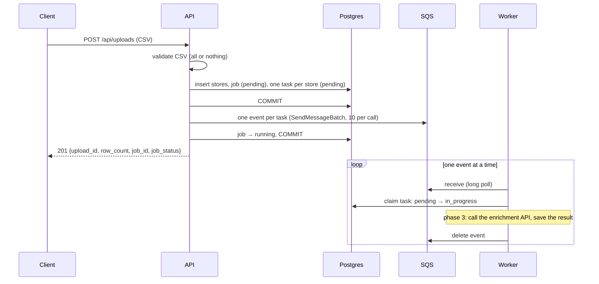

# Architecture

How TierForge's backend stores its data and how the API hands work to the worker. Retries, backoff and other resilience features are out of scope here; they come in phase 6 (see [implementation-phases.md](implementation-phases.md)).

## Components

| Component | Runs as | Talks to |
| --- | --- | --- |
| API (FastAPI) | `poe api` | Postgres, SQS (sends events) |
| Worker | `poe worker` | SQS (receives and deletes events), Postgres, enrichment simulator (from phase 3) |
| Postgres | your local instance / RDS | — |
| SQS queue `tierforge-enrichment` | LocalStack locally, Terraform in AWS | — |

## Layers

| Layer | Owns | Example |
| --- | --- | --- |
| Routes | HTTP: request parsing, status codes | `POST /api/uploads` |
| Services (`<feature>_service.py`) | business rules: which status a job or task moves to, which timestamps are set, what gets committed when | `EnrichmentJobService`, `EnrichmentTaskService` |
| Repositories | data access only: create, bulk create, update the fields they're given | `JobRepository.update(job_id, JobUpdate(...))` |

Repositories take Pydantic models (`JobCreate`, `JobUpdate`, `EnrichmentTaskCreate`, `EnrichmentTaskUpdate` in `api/schemas/`), and an update writes only the fields that were passed (`exclude_unset`). The worker uses the same services, building them on its own session.

One exception: `EnrichmentTaskRepository.update_if_status` checks the task's current status and writes the change in a single SQL statement. If a service read the status first and then updated it, two workers could both see `pending` and both claim the same task. The service chooses the transition (e.g. `pending` → `in_progress`); the repository keeps one fixed rule, which is to never touch tasks of a failed job.

## Upload to enrichment flow



Rules that keep this consistent:
- **Commit before sending.** Stores, job and tasks are committed before any event goes out, so the worker never receives an event for a row it can't see.
- **If sending fails,** the job is marked `failed` with the reason, and the upload returns 503. The stores stay saved. Events already sent are skipped by the worker, because their job has failed.
- **Claiming is guarded.** The worker only moves a task from `pending` to `in_progress` if the task is still `pending` and its job hasn't failed. A duplicate delivery of the same event changes nothing.
- **One event per store.** Each event is one unit of work, so SQS can spread work across workers, and each store is delivered and deleted on its own. Measured locally: 5,000 events sent in about 1 s; the whole upload took 1.2 s.

## Data stores

The exact schema, with every column, index and constraint, is in **[datastores.md](datastores.md)**. In short:

| Table | One row per | Written by | Since |
| --- | --- | --- | --- |
| `stores` | row of an uploaded CSV | upload, once | phase 1 |
| `jobs` | enrichment run of one upload | upload (create, `running` / `failed`); worker (completion, phase 3) | phase 2 |
| `enrichment_tasks` | store within a job: the unit of work, and its result from phase 3 | upload (create); worker (status, results) | phase 2 |

Statuses are plain `TEXT` in Postgres and `StrEnum`s in Python (`JobStatus`, `TaskStatus`).

## SQS events

Every message on the queue is the same envelope with a typed payload, defined in `api/schemas/messages.py`:

```python
class SQSEvent(BaseModel, Generic[PayloadT]):
    version: int = EVENT_VERSION                        # event format version
    timestamp: datetime = <now, UTC>                    # when the event was created
    payload: PayloadT                                   # a Pydantic model

class EnrichStorePayload(BaseModel):
    job_id: int
    task_id: int

EnrichmentEvent = SQSEvent[EnrichStorePayload]
```

Example message body:

```json
{
  "version": 1,
  "timestamp": "2026-10-23T10:15:30.123456Z",
  "payload": {"job_id": 7, "task_id": 1234}
}
```

| Field | Type | Meaning |
| --- | --- | --- |
| `version` | integer | Format version of the envelope and payload. The worker deletes events whose version it doesn't support, since retrying can't fix them. |
| `timestamp` | ISO 8601, UTC | When the API created the event |
| `payload` | object | Event-specific data, typed per event: `EnrichStorePayload` for enrichment |

**Why the payload is just two IDs:** the task row already holds the store, the job and the status. Keeping the event small avoids sending store data twice and keeps the database the single source of truth.

**Typing:** `SQSEvent` is generic, so each event type is a parameterised model (`SQSEvent[EnrichStorePayload]`). The payload is validated and serialised as its own model, and the worker gets a typed object back. Always use the parameterised type; `SQSEvent[Any]` is possible but loses validation.

**Changing the format:**
- **Adding an optional field** to a payload is backward compatible; keep the version.
- **Any change older workers can't read** (renaming or removing a field, changing its meaning) means bumping `EVENT_VERSION`. Deploy workers that read both versions before the API starts sending the new one.
- **A new kind of event** gets its own payload model and alias (e.g. `ScoreJobEvent = SQSEvent[ScoreJobPayload]`). If it shares this queue, add an event-type field so the worker can tell events apart.

**Queue and IAM:** the API sends to the queue named in `SQS_ENRICHMENT_QUEUE_URL` and needs `sqs:SendMessage`. The worker needs `sqs:GetQueueAttributes` (startup check), `sqs:ReceiveMessage` and `sqs:DeleteMessage`.
