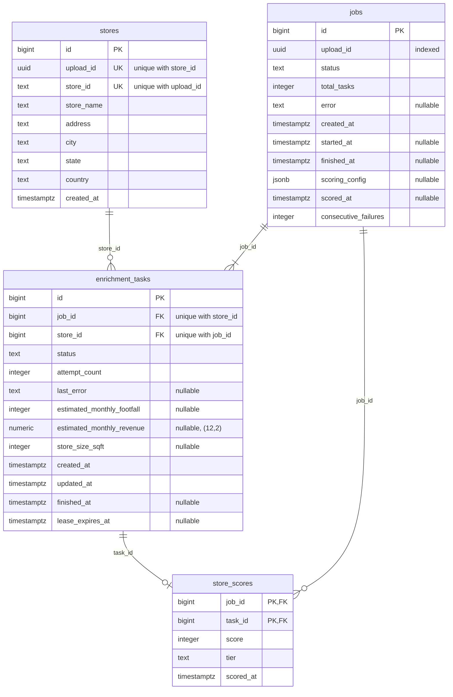

# Data stores

The Postgres tables as they exist today. How they're used: [architecture.md](architecture.md).

`jobs.upload_id` matches `stores.upload_id`, linking a job to the stores it enriches.

## `stores`

One row per row of an uploaded CSV. Written once by the upload and never changed.

| Column       | Type          | Null     | Default  | Notes                                    |
| ------------ | ------------- | -------- | -------- | ---------------------------------------- |
| `id`         | `bigint`      | not null | sequence | primary key                              |
| `upload_id`  | `uuid`        | not null |          | shared by every row of one uploaded file |
| `store_id`   | `text`        | not null |          | the CSV's own ID, e.g. `ST000001`        |
| `store_name` | `text`        | not null |          |                                          |
| `address`    | `text`        | not null |          |                                          |
| `city`       | `text`        | not null |          |                                          |
| `state`      | `text`        | not null |          |                                          |
| `country`    | `text`        | not null |          |                                          |
| `created_at` | `timestamptz` | not null | `now()`  |                                          |

| Constraint / index             | Definition                                                                                                |
| ------------------------------ | --------------------------------------------------------------------------------------------------------- |
| `pk_stores`                    | `PRIMARY KEY (id)`                                                                                        |
| `uq_stores_upload_id_store_id` | `UNIQUE (upload_id, store_id)`: a store ID appears once per upload; also serves "all stores of an upload" |

## `jobs`

One row per enrichment run, created by the upload.

| Column                 | Type          | Null     | Default         | Notes                                                                                                                                                                         |
| ---------------------- | ------------- | -------- | --------------- | ----------------------------------------------------------------------------------------------------------------------------------------------------------------------------- |
| `id`                   | `bigint`      | not null | sequence        | primary key                                                                                                                                                                   |
| `upload_id`            | `uuid`        | not null |                 | the upload whose stores this job enriches                                                                                                                                     |
| `status`               | `text`        | not null | `pending` (app) | see below                                                                                                                                                                     |
| `total_tasks`          | `integer`     | not null |                 | number of stores                                                                                                                                                              |
| `error`                | `text`        | null     |                 | why the job failed                                                                                                                                                            |
| `created_at`           | `timestamptz` | not null | `now()`         |                                                                                                                                                                               |
| `started_at`           | `timestamptz` | null     |                 | when every event was sent                                                                                                                                                     |
| `finished_at`          | `timestamptz` | null     |                 | when the job ended: it `failed`, or its last task finished                                                                                                                    |
| `scoring_config`       | `jsonb`       | null     |                 | the settings its stores were last scored with (bars, weights, tiers, as sent to the scoring endpoint); null until first scored                                                |
| `scored_at`            | `timestamptz` | null     |                 | when the job was last scored; null until then. Kept on the job because a job with no succeeded stores has no `store_scores` rows to carry it                                  |
| `consecutive_failures` | `integer`     | not null | `0`             | failed enrichment calls in a row across the job's tasks; any success resets it to 0. The circuit breaker fails the job when it reaches `ENRICHMENT_CIRCUIT_BREAKER_THRESHOLD` |

| Constraint / index  | Definition          |
| ------------------- | ------------------- |
| `pk_jobs`           | `PRIMARY KEY (id)`  |
| `ix_jobs_upload_id` | `INDEX (upload_id)` |

| `status`                  | Meaning                                        |
| ------------------------- | ---------------------------------------------- |
| `pending`                 | job and tasks saved; events not sent yet       |
| `running`                 | every event sent; the worker is processing     |
| `failed`                  | the events couldn't be sent (`error` says why) |
| `completed`               | every task succeeded                           |
| `completed_with_failures` | every task finished, some failed               |

## `enrichment_tasks`

One row per store in a job: the unit of work. One SQS event is sent per task. It also holds the store's enrichment result once the call succeeds.

| Column                       | Type            | Null     | Default         | Notes                                                                                                                                                                                                 |
| ---------------------------- | --------------- | -------- | --------------- | ----------------------------------------------------------------------------------------------------------------------------------------------------------------------------------------------------- |
| `id`                         | `bigint`        | not null | sequence        | primary key; the event's `task_id`                                                                                                                                                                    |
| `job_id`                     | `bigint`        | not null |                 | → `jobs.id`                                                                                                                                                                                           |
| `store_id`                   | `bigint`        | not null |                 | → `stores.id`                                                                                                                                                                                         |
| `status`                     | `text`          | not null | `pending` (app) | see below                                                                                                                                                                                             |
| `attempt_count`              | `integer`       | not null | `0`             | enrichment calls made                                                                                                                                                                                 |
| `last_error`                 | `text`          | null     |                 | why the last call failed                                                                                                                                                                              |
| `estimated_monthly_footfall` | `integer`       | null     |                 | from the enrichment API; set when `succeeded`                                                                                                                                                         |
| `estimated_monthly_revenue`  | `numeric(12,2)` | null     |                 | from the enrichment API; set when `succeeded`                                                                                                                                                         |
| `store_size_sqft`            | `integer`       | null     |                 | from the enrichment API; set when `succeeded`                                                                                                                                                         |
| `created_at`                 | `timestamptz`   | not null | `now()`         |                                                                                                                                                                                                       |
| `updated_at`                 | `timestamptz`   | not null | `now()`         | set to `now()` on every update                                                                                                                                                                        |
| `finished_at`                | `timestamptz`   | null     |                 | when the task became `succeeded` or `failed`                                                                                                                                                          |
| `lease_expires_at`           | `timestamptz`   | null     |                 | until when the handler that claimed the task owns it; null unless `in_progress`. Once past, the task can be claimed again; the outcome is only written while it still holds the value its handler set |

| Constraint / index                    | Definition                                                                                                                                         |
| ------------------------------------- | -------------------------------------------------------------------------------------------------------------------------------------------------- |
| `pk_enrichment_tasks`                 | `PRIMARY KEY (id)`                                                                                                                                 |
| `fk_enrichment_tasks_job_id_jobs`     | `FOREIGN KEY (job_id) REFERENCES jobs(id) ON DELETE CASCADE`                                                                                       |
| `fk_enrichment_tasks_store_id_stores` | `FOREIGN KEY (store_id) REFERENCES stores(id)`                                                                                                     |
| `uq_enrichment_tasks_job_id_store_id` | `UNIQUE (job_id, store_id)`: one task per store per job; also serves "all tasks of a job"                                                          |
| `ix_enrichment_tasks_job_id_status`   | `INDEX (job_id, status)`: task counts per status of a job, used by the worker after each task to see whether the job is finished, and for progress |

| `status`      | Meaning                                                                                    |
| ------------- | ------------------------------------------------------------------------------------------ |
| `pending`     | waiting for the worker                                                                     |
| `in_progress` | claimed by the worker                                                                      |
| `retrying`    | a call failed and attempts are left (or it was a 429); waiting for its delayed retry event |
| `succeeded`   | enriched                                                                                   |
| `failed`      | the enrichment call failed (`last_error` says why)                                         |

## `store_scores`

One row per scored store in a job: the store's score and tier from the job's latest scoring. Only `succeeded` tasks are scored. Every scoring run of a job deletes and rewrites all of that job's rows in one transaction.

| Column      | Type          | Null     | Default | Notes                                                                     |
| ----------- | ------------- | -------- | ------- | ------------------------------------------------------------------------- |
| `job_id`    | `bigint`      | not null |         | → `jobs.id`                                                               |
| `task_id`   | `bigint`      | not null |         | → `enrichment_tasks.id`: the scored store's task, which holds its metrics |
| `score`     | `integer`     | not null |         | 0-100: the sum of the weights of the bars the store meets                 |
| `tier`      | `text`        | not null |         | `large`, `medium` or `small`                                              |
| `scored_at` | `timestamptz` | not null | `now()` | when the scoring run happened; the same for every row of one run          |

| Constraint / index                         | Definition                                                                                                                       |
| ------------------------------------------ | -------------------------------------------------------------------------------------------------------------------------------- |
| `pk_store_scores`                          | `PRIMARY KEY (job_id, task_id)`: one score per store per job; also serves "all scores of a job" (the delete before each rewrite) |
| `fk_store_scores_job_id_jobs`              | `FOREIGN KEY (job_id) REFERENCES jobs(id) ON DELETE CASCADE`                                                                     |
| `fk_store_scores_task_id_enrichment_tasks` | `FOREIGN KEY (task_id) REFERENCES enrichment_tasks(id) ON DELETE CASCADE`                                                        |
| `ix_store_scores_job_id_tier`              | `INDEX (job_id, tier)`: counts per tier, and the store list filtered by tier                                                     |

## Notes

- **Statuses and tiers** are plain `TEXT`. The values come from the `StrEnum`s `JobStatus`, `TaskStatus` and `Tier` in `backend/api/models/enums.py`. The app sets the `pending` defaults; neither the app nor the database rejects other values.
- **Enrichment results** live on the task rather than in a separate table: each task has at most one result, and scoring reads the metrics of a job's `succeeded` tasks. The three metric columns use the enrichment API's own field names. Revenue is `numeric(12,2)` (exact to the cent; `Decimal` in Python), not a float.
- **Scores live apart from metrics:** metrics are slow to get and never change; scores are cheap and rewritten on every scoring run. Keeping them in separate tables means re-scoring can never touch enrichment data.
- **Only the latest scoring settings** are kept, on `jobs.scoring_config`; there is no history of earlier settings.
- **Constraint and index names** follow the convention in `backend/api/models/base.py`: `pk_`, `uq_`, `fk_`, `ix_`.
