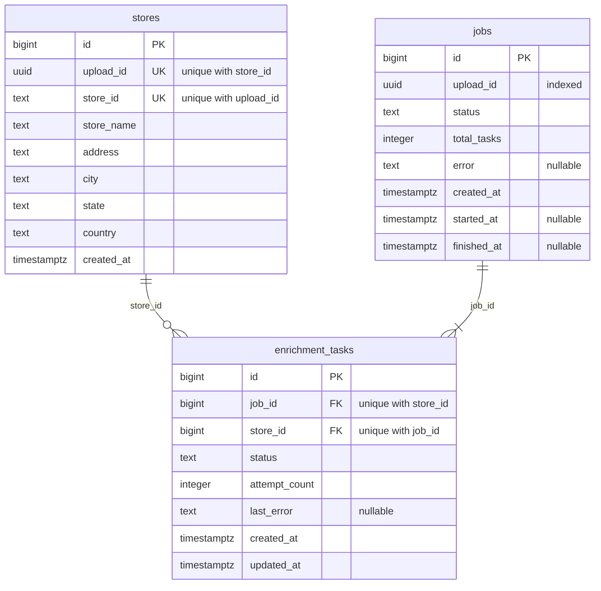

# Data stores

The Postgres tables as they exist today. How they're used: [architecture.md](architecture.md).

`jobs.upload_id` matches `stores.upload_id`, linking a job to the stores it enriches.

## `stores`

One row per row of an uploaded CSV. Written once by the upload and never changed.

| Column | Type | Null | Default | Notes |
| --- | --- | --- | --- | --- |
| `id` | `bigint` | not null | sequence | primary key |
| `upload_id` | `uuid` | not null | | shared by every row of one uploaded file |
| `store_id` | `text` | not null | | the CSV's own ID, e.g. `ST000001` |
| `store_name` | `text` | not null | | |
| `address` | `text` | not null | | |
| `city` | `text` | not null | | |
| `state` | `text` | not null | | |
| `country` | `text` | not null | | |
| `created_at` | `timestamptz` | not null | `now()` | |

| Constraint / index | Definition |
| --- | --- |
| `pk_stores` | `PRIMARY KEY (id)` |
| `uq_stores_upload_id_store_id` | `UNIQUE (upload_id, store_id)`: a store ID appears once per upload; also serves "all stores of an upload" |

## `jobs`

One row per enrichment run, created by the upload.

| Column | Type | Null | Default | Notes |
| --- | --- | --- | --- | --- |
| `id` | `bigint` | not null | sequence | primary key |
| `upload_id` | `uuid` | not null | | the upload whose stores this job enriches |
| `status` | `text` | not null | `pending` (app) | see below |
| `total_tasks` | `integer` | not null | | number of stores |
| `error` | `text` | null | | why the job failed |
| `created_at` | `timestamptz` | not null | `now()` | |
| `started_at` | `timestamptz` | null | | when every event was sent |
| `finished_at` | `timestamptz` | null | | when the job ended |

| Constraint / index | Definition |
| --- | --- |
| `pk_jobs` | `PRIMARY KEY (id)` |
| `ix_jobs_upload_id` | `INDEX (upload_id)` |

| `status` | Meaning |
| --- | --- |
| `pending` | job and tasks saved; events not sent yet |
| `running` | every event sent; the worker is processing |
| `failed` | the events couldn't be sent (`error` says why) |
| `completed` | every task succeeded |
| `completed_with_failures` | every task finished, some failed |

## `enrichment_tasks`

One row per store in a job: the unit of work. One SQS event is sent per task.

| Column | Type | Null | Default | Notes |
| --- | --- | --- | --- | --- |
| `id` | `bigint` | not null | sequence | primary key; the event's `task_id` |
| `job_id` | `bigint` | not null | | → `jobs.id` |
| `store_id` | `bigint` | not null | | → `stores.id` |
| `status` | `text` | not null | `pending` (app) | see below |
| `attempt_count` | `integer` | not null | `0` | enrichment calls made |
| `last_error` | `text` | null | | why the last call failed |
| `created_at` | `timestamptz` | not null | `now()` | |
| `updated_at` | `timestamptz` | not null | `now()` | set to `now()` on every update |

| Constraint / index | Definition |
| --- | --- |
| `pk_enrichment_tasks` | `PRIMARY KEY (id)` |
| `fk_enrichment_tasks_job_id_jobs` | `FOREIGN KEY (job_id) REFERENCES jobs(id) ON DELETE CASCADE` |
| `fk_enrichment_tasks_store_id_stores` | `FOREIGN KEY (store_id) REFERENCES stores(id)` |
| `uq_enrichment_tasks_job_id_store_id` | `UNIQUE (job_id, store_id)`: one task per store per job; also serves "all tasks of a job" |
| `ix_enrichment_tasks_job_id_status` | `INDEX (job_id, status)`: progress counts per job |

| `status` | Meaning |
| --- | --- |
| `pending` | waiting for the worker |
| `in_progress` | claimed by the worker |
| `succeeded` | enriched |
| `failed` | the enrichment call failed (`last_error` says why) |

## Notes

- **Statuses** are plain `TEXT`. The values come from the `StrEnum`s `JobStatus` and `TaskStatus` in `backend/api/models/enums.py`. The app sets the `pending` defaults; neither the app nor the database rejects other values.
- **Constraint and index names** follow the convention in `backend/api/models/base.py`: `pk_`, `uq_`, `fk_`, `ix_`.
